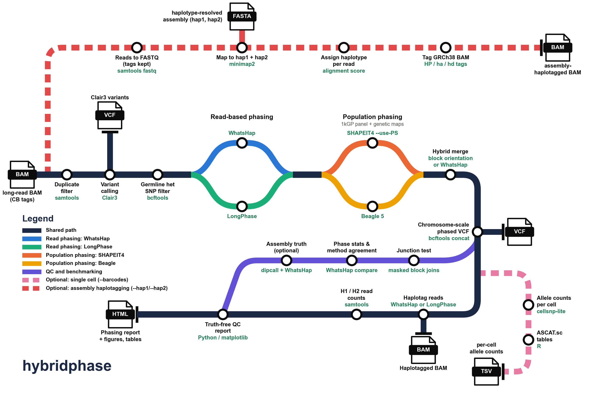

# hybridphase

Nextflow pipeline for **hybrid phasing of long-read data**: read-based phase blocks
(WhatsHap or LongPhase) are joined into chromosome-scale haplotypes with a population
reference panel (SHAPEIT4 or Beagle). Then the BAM is haplotagged and a **truth-free QC
report** is written.



## Quick start

```bash
nextflow run main.nf -profile vsc_mindwell \
    --sample COLO829BL --bam COLO829BL.bam --ref GRCh38.fasta \
    --clair3_model_dir /path/to/clair3_models --clair3_model r1041_e82_400bps_sup_v520 \
    --clair3_container hkubal-clair3_v2.0.0.sif --phasing_container hybridphase.sif \
    --read_phaser whatshap,longphase --pop_phaser shapeit4,beagle
```

or with a params file: `examples/colo829bl.params.yaml`, submitted as a head job with
`examples/submit_vsc.slurm`. Use `-resume` after a failure.

Skip Clair3 with an existing VCF: `--vcf merge_output.vcf.gz`.

## Containers

| step | container |
|---|---|
| Clair3 | `hkubal/clair3:v2.0.0` (`--clair3_container`, a local `.sif` works) |
| everything else | `containers/hybridphase.def` → `apptainer build hybridphase.sif containers/hybridphase.def` |

The phasing container has bcftools, WhatsHap, LongPhase, SHAPEIT4, Beagle, cellsnp-lite,
R and python (pysam, pandas, matplotlib), plus the 1kGP high-coverage panel and genetic maps
baked into `/opt/ref_data`. Build it once on the cluster
(the panel and map source paths are set in its `%files` section).

To use a panel outside the container: `--panel_dir`, `--panel_name '{chr}.bcf'`, `--map_dir`,
`--map_name`, and add the folders to `--extra_binds`.

## Methods

**Read phasers** (`--read_phaser`, per chromosome)
- `whatshap`: `whatshap phase --ignore-read-groups`
- `longphase`: `longphase phase --ont` (or `--pb` with `--platform hifi`)

**Population phasers** (`--pop_phaser`, per chromosome)
- `shapeit4`: `--use-PS 0.001 --sequencing`. Read blocks are kept intact and oriented with the panel.
- `beagle`: Beagle 5 with `impute=false`. It cannot use read blocks, so it phases the het SNPs from the
  panel alone (one run per chromosome, shared by all read phasers).
- `none`: read blocks only.

Lists run every combination (e.g. 2 × 2 = 4 results); the report compares them.

**Hybrid merge** (`--hybrid_merge`)
- `orient` (default): `bin/hybrid_merge.py` flips each read block as a whole to the majority orientation of
  the population phase at the SNPs both share (≥ `--orient_min_snps`). SNPs outside the panel keep their
  read phase, panel SNPs outside read blocks take the population phase. The read phaser's blocks are never
  changed, so this works the same way for WhatsHap and LongPhase.
- `whatshap`: `whatshap phase` with the reads and the population VCF as an
  extra pseudo-read. With LongPhase as read phaser this re-phases the reads with WhatsHap.

**Haplotagging**: `whatshap haplotag` (default) or `longphase haplotag` (`--haplotag_tool`) with the first
combination, or the one given with `--haplotag_combo whatshap_shapeit4`.

**Optional single-cell step**: with `--barcodes`, cellsnp-lite on the phased SNPs and per-cell ASCAT.sc
allele count tables (bash steps 4–5).

## Truth-free QC report

`<outdir>/<sample>/04_qc/phasing_report.html` is one self-contained page (figures in `figures/`, data in
`tables/`). There is no truth set, so it uses what can be checked from the data itself:

| section | what it shows |
|---|---|
| Variant calling | filter funnel, VAF / depth / QUAL distributions with the thresholds, het SNP density per chromosome (low = LOH or low coverage) |
| Completeness | % het SNPs phased and block N50 per chromosome, read-only vs hybrid; read block length distribution |
| Read blocks vs population | ideogram of read blocks coloured by how well the population phase agrees with them; orientation success vs block size; switches between read-only and final phasing |
| **Junction test** | masking benchmark (`bin/junction_test.py`): every read block with ≥ 10 SNPs is split in two, the population phaser re-joins the halves blind, and the reads say which way is right. Error rate per gap size, with the gap distribution of the real block junctions next to it |
| Method agreement | pairwise switch rate and block-wise Hamming between all combinations |
| Haplotagged BAM | % reads H1 / H2 / untagged per chromosome; H1 read fraction in 1 Mb bins along the genome. Normal tissue sits at 0.5; CNAs / LOH move whole segments away from it, and switch errors show as jumps between mirrored levels |
| Assembly haplotagging | optional, see below: assignment per read length, H1 fraction along the genome, per-cell counts, agreement with the VCF-based haplotags |
| Assembly truth | optional, see below: accuracy against a truth from a diploid assembly |
| Single cells | covered SNPs and depth per cell (with `--barcodes`) |

## Optional: haplotagging with a haplotype-resolved assembly

With `--hap1 / --hap2` (the two haplotype FASTAs of a diploid assembly of the same individual) the reads are
also tagged **directly from the assembly**, without variant calling or statistical phasing:

1. hap1 and hap2 are combined into one diploid reference (contigs renamed `h1_*` / `h2_*`) and indexed with minimap2
2. the primary reads of the input BAM are extracted (`CB` / `UB` tags kept) and mapped to it, with secondary alignments
3. per read, the best alignment score on hap1 is compared with the best on hap2: a difference of at least
   `--asm_min_diff` (default 6, about one het SNV for the ONT scoring) assigns H1 or H2; equal scores
   (homozygous stretches, short fragments without a het site) leave the read unassigned
4. the original GRCh38 BAM gets `HP:i` (1/2), `ha:Z` (assembly contig) and `hd:i` (score difference)

This works for long-read BAMs and for BAMs with a mix of short and long fragments (single-cell DNA); the report
shows the assigned share per read length, the H1 fraction along the genome, per-cell H1/H2 counts when
reads carry `CB`, and the per-read agreement with the VCF-based haplotags. H1/H2 are consistent along a whole
chromosome only if the assembly is phased chromosome-wide (trio or Hi-C); otherwise per contig (`ha` tag).
Turn it off with `--assembly_haplotag false`.

## Optional: benchmark against an assembly truth

The same `--hap1 / --hap2` also give a truth set (dipcall), against which every phased VCF of the run
(read-only and hybrid) is compared (`--assembly_truth false` to skip):

```bash
--hap1 asm.hap1.fa --hap2 asm.hap2.fa            # dipcall -> truth VCF + confident regions
--dipcall_args '-x hs38.PAR.bed'                 # male samples: PAR handling (path inside the dipcall container)
--truth_vcf truth.dip.vcf.gz --truth_bed truth.dip.bed   # or reuse an existing truth (dipcall skipped)
```

Only confident truth calls are used (inside the BED, unflagged), and `whatshap compare --only-snvs` is run per
VCF. The report gets an extra section: switch, long-range switch and flip counts, block-wise Hamming per
chromosome, and a mosaic of where each chromosome is phased like the truth or has its haplotypes swapped.

## Output

```
<outdir>/<sample>/
  01_variant_calling/   Clair3 VCF, germline_het_snps.vcf.gz, filter QC
  02_read_phasing/<read_phaser>/          <read>_reads.phased.vcf.gz + stats
  03_hybrid_phasing/<read>_<pop>/         <read>_<pop>.phased.vcf.gz, phases_for_ascat.vcf.gz, stats, reads-vs-final compare
  04_qc/                phasing_report.html, figures/, tables/, junction_test/, block_orientation/, method_concordance.tsv,
                        truth/ (optional: dipcall truth, whatshap compare per VCF)
  05_haplotag/          <sample>.<combo>.haplotagged.bam(.bai), haplotag list, haplotag_counts.tsv
    assembly/           <sample>.assembly_haplotagged.bam, <sample>.asm.bam (reads on hap1+hap2), per-read assignments,
                        per-cell H1/H2 counts (optional)
  06_single_cell/       cellsnp/, ascat_allele_counts/ (optional)
pipeline_info/          Nextflow timeline, report, trace, DAG
```

## Main parameters

| parameter | default | |
|---|---|---|
| `--drop_duplicates` | true | remove 0x400-flagged reads before calling / phasing |
| `--chroms` | `1-22` | e.g. `21,22` for a test |
| `--min_qual / --min_dp / --min_vaf / --max_vaf` | 20 / 15 / 0.25 / 0.75 | het SNP filter |
| `--shapeit4_use_ps` | 0.001 | |
| `--orient_min_snps` | 2 | |
| `--junction_test` | true | |
| `--haplotag` | true | |
| `--hap1 / --hap2` | – | haplotype-resolved assembly: assembly haplotagging + truth benchmark |
| `--asm_min_diff` | 6 | alignment-score difference needed to assign a read to a haplotype |
| `--truth_vcf / --truth_bed` | – | existing truth instead of dipcall |

All parameters with comments: `nextflow.config`. Resources per step: `conf/base.config`.

## Tests

`tests/run_script_tests.sh` runs the python helpers and the report on synthetic data (known haplotypes,
short read blocks, a population phase with long-range switch errors) and checks that the merge never
breaks a read block. It needs only python with pysam, pandas and matplotlib. A full test run on real data:
`-profile vsc_mindwell,test` (chr21–22, all four combinations).

## Citations

Tools used by the pipeline: [CITATIONS.md](CITATIONS.md). Changes: [CHANGELOG.md](CHANGELOG.md).
